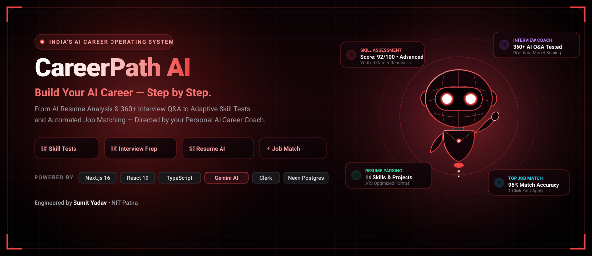

# CareerPath AI — India's AI Career Operating System

<p align="center">
  
</p>

<p align="center">
  <a href="https://nextjs.org"></a>
  <a href="https://react.dev"></a>
  <a href="https://www.typescriptlang.org"></a>
  <a href="https://tailwindcss.com"></a>
  <a href="https://ai.google.dev"></a>
  <a href="https://neon.tech"></a>
  <a href="https://clerk.com"></a>
  <a href="https://vercel.com"></a>
</p>

---

## 🚀 Overview

**CareerPath AI** is an all-in-one AI career acceleration platform engineered for students, engineers, and professionals building careers in the modern AI economy.

Rather than juggling fragmented tools for resume editing, interview prep, skill testing, and job applications, CareerPath AI consolidates the entire journey into an intelligent workspace guided by an interactive **Personal AI Career Coach**.

---

## ✨ Key Features

### 🎯 1. AI Skill Assessments & Adaptive Testing (`/dashboard/tests`)
- **Curated & Dynamic AI Tests**: Take high-yield assessments in Generative AI, Large Language Models (LLMs), Prompt Engineering, Python for AI, Math for ML, and RAG & Vector Databases.
- **Custom Test Generation**: Dynamically generate tailored multi-question assessments for any tech stack or role using **Google Gemini 2.5 Flash**.
- **Timed Assessment Interface**: Real-time timer, progress tracking, flagged questions, and instant submission.
- **Deep AI Performance Analysis**: Comprehensive evaluation detailing score percentage, percentile ranking (*e.g., Top 5%*), strengths, knowledge gaps, and actionable study roadmaps.

### 💬 2. AI Mock Interview & Technical Prep (`/dashboard/interview`)
- **360+ Curated Interview Q&A**: Verified questions frequently asked by Indian and global tech firms for AI and Software Engineering roles.
- **Interactive AI Mock Interviewer**: Practice live interview questions with AI feedback, speech/text support, and instant answer evaluations.
- **Scoring & Model Answers**: Compares your responses against industry-standard model answers to pinpoint areas for technical improvement.

### 📄 3. AI Resume Intelligence (`/dashboard/resume`)
- **Automated Resume Parsing**: Upload PDF or DOCX resumes; the AI extracts technical skills, years of experience, projects, and education.
- **ATS Compatibility & Scoring**: Receive real-time feedback on ATS formatting, keyword density, and role-readiness benchmarks.
- **One-Click Profile Sync**: Extracted skills and credentials automatically populate your candidate profile.

### ⚡ 4. Smart Job Discovery & Skill-Based Matching (`/dashboard/jobs`)
- **AI Match Engine**: Analyzes your parsed profile against job listings to provide an exact percentage match score (*e.g., 96% Match*).
- **Advanced Filtering**: Filter by experience level, tech stack, salary ranges (*e.g., ₹28L–₹36L*), and location (Bengaluru, Gurgaon, Hyderabad, Remote).
- **1-Click Apply & Saved Jobs**: Bookmark opportunities or apply directly with your tailored profile.

### 📊 5. Application Tracking & Progress Management (`/dashboard/applications`)
- **Application Pipeline**: Track the lifecycle of every job application through *Applied*, *Under Review*, *Interview Scheduled*, and *Offer*.
- **Career Readiness Radar**: Monitor your profile completeness and ongoing test scores to know when you are interview-ready.

---

## 🛠️ Tech Stack

| Layer | Technology |
|---|---|
| **Framework** | [Next.js 16](https://nextjs.org) (App Router, Turbopack, Server Actions) |
| **Frontend** | [React 19](https://react.dev), [Tailwind CSS 4](https://tailwindcss.com), [Lucide Icons](https://lucide.dev) |
| **Artificial Intelligence** | [Google Gemini 2.5 Flash / Pro API](https://ai.google.dev) (`@google/genai`) |
| **Authentication** | [Clerk Auth](https://clerk.com) (JWT Session Validation, Deprecated Middleware to Proxy Migration) |
| **Database & ORM** | [Neon Serverless PostgreSQL](https://neon.tech), [Drizzle ORM](https://orm.drizzle.team) |
| **Document Parsing** | `pdf2json`, `mammoth` (DOCX extraction) |
| **Payments & Billing** | [Stripe](https://stripe.com) (Subscriptions & Checkout) |
| **Hosting & CI/CD** | [Vercel](https://vercel.com) |

---

## 📁 Project Architecture & Modular Folder Structure

CareerPath AI is organized into clearly separated architectural domains:

```text
CareerPath_AI/
├── README.md                          # Repository documentation
├── careerpath-ai-banner.svg           # High-resolution cyberpunk banner
└── careerpath-ai/                     # Main full-stack application root
    │
    ├── 📁 backend/                    # Server-side architecture & database
    │   ├── db/                        # Neon PostgreSQL & Drizzle ORM schema, index, seed & user-sync
    │   ├── services/                  # Business logic (job sync, matching engine, Stripe billing)
    │   ├── proxy.ts                   # Clerk auth proxy & JWT clock-skew synchronization
    │   └── README.md                  # Backend architecture documentation
    │
    ├── 📁 ai-resume/                  # AI Resume & Career Intelligence Engine
    │   ├── resume/                    # Multi-format parser (PDF/DOCX) & Gemini 2.5 ATS analyzer
    │   ├── interview/                 # 360+ curated questions & interactive AI mock interviewer
    │   ├── tests/                     # Curated domain tests & Gemini dynamic assessment generator
    │   └── README.md                  # AI engine & prompt architecture documentation
    │
    ├── 📁 frontend/                   # Client-side UI & design system
    │   ├── components/                # Reusable UI widgets, dashboard panels, hero & navigation
    │   └── README.md                  # Frontend components documentation
    │
    ├── 📁 app/                        # Next.js 16 App Router
    │   ├── api/                       # REST API route handlers (connecting frontend to backend/ai)
    │   ├── dashboard/                 # Interactive dashboard workspaces (tests, interview, resume, jobs)
    │   ├── page.tsx                   # Landing page featuring CareerPathAiBotHero
    │   └── layout.tsx                 # Root layout with ClerkProvider & metadata
    │
    ├── 📁 public/                     # Static assets, icons, SVG banners & media
    ├── package.json                   # Dependencies & npm scripts
    ├── tsconfig.json                  # Path aliases (@backend/*, @ai-resume/*, @frontend/*)
    └── .env.example                   # Environment variables template
```

---

## ⚡ Getting Started Locally

### 1. Prerequisites
- **Node.js**: `v20.x` or higher
- **npm** or **pnpm**
- A free **Neon PostgreSQL** database instance
- A free **Clerk** account for authentication
- A free **Google Gemini API** key

### 2. Clone the Repository
```bash
git clone https://github.com/Sumit-Yadav2611/CareerPath_AI.git
cd CareerPath_AI/careerpath-ai
```

### 3. Install Dependencies
```bash
npm install
```

### 4. Configure Environment Variables
Create `.env.local` inside the `careerpath-ai/` directory:
```env
# Clerk Authentication
NEXT_PUBLIC_CLERK_PUBLISHABLE_KEY=pk_test_...
CLERK_SECRET_KEY=sk_test_...

# Neon PostgreSQL Database
DATABASE_URL=

# Google Gemini AI
GEMINI_API_KEY=AIzaSy...

# Application URL
NEXT_PUBLIC_APP_URL=http://localhost:3000

# Stripe (Optional)
STRIPE_SECRET_KEY=sk_test_...
NEXT_PUBLIC_STRIPE_PUBLISHABLE_KEY=
STRIPE_WEBHOOK_SECRET=
```

### 5. Push Database Schema
```bash
npm run db:push
```

### 6. Run the Development Server
```bash
npm run dev
```
Open [http://localhost:3000](http://localhost:3000) in your browser.

---

## 🌐 Deploying to Vercel

1. Open your **[Vercel Dashboard](https://vercel.com/dashboard)** and click **Add New... → Project**.
2. Select your repository: **`Sumit-Yadav2611/CareerPath_AI`**.
3. **Configure Root Directory**:
   - In the project setup, click **Edit** next to **Root Directory**.
   - Select **`careerpath-ai`** and click **Continue**.
4. **Add Environment Variables**:
   - Add `NEXT_PUBLIC_CLERK_PUBLISHABLE_KEY`, `CLERK_SECRET_KEY`, `DATABASE_URL`, `GEMINI_API_KEY`, and `NEXT_PUBLIC_APP_URL`.
5. Click **Deploy**. Vercel will build the Next.js app and provide your live production URL.

---

## 👨‍💻 Author

**Sumit Yadav**
- **GitHub**: [@Sumit-Yadav2611](https://github.com/Sumit-Yadav2611)
- **LinkedIn**: [Sumit Yadav](https://www.linkedin.com/in/sumit-yadav-8a8929357/)
- **YouTube**: [Sumit Krishna NITp - YouTube](https://www.youtube.com/@sumitkrishnanitp)

---

## 📄 License

This project is licensed under the [MIT License](LICENSE).
